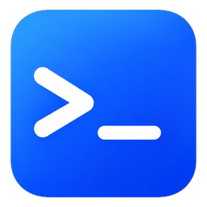

<div align="center">



# LaterTerm

[](https://www.rust-lang.org/)
[](LICENSE)
[]()
[](https://github.com/ailater/LaterTerm/actions/workflows/ci.yml)

**跨平台 GPU 终端 · Rust + GPUI · 远程服务器管理 · 终端内文件传输**

为中文开发者打造的原生终端：Deepin 终端的功能 × Tabby 的颜值 × 原生的性能。

[特性](#特性) · [安装](#安装) · [技术栈](#技术栈) · [开发](#开发)

</div>

## 特性

### 终端本体

- ⚡ **GPU 渲染** — GPUI 文本管线，连字 / CJK / emoji / HiDPI 原生支持
- 🧩 **多标签 + 嵌套分屏** — H/V 任意分屏（Ctrl+J/K），焦点循环，标签栏 × / 窗格角标双级关闭
- ⌨️ **中文 IME** — 预编辑下划线浮层 + 候选框光标跟随
- 🔍 **回滚搜索** — 10 万行缓冲 + Ctrl+Shift+F 全文搜索（含 CJK 宽字符）
- 🏷️ **提示符标记** — OSC 133 shell 集成：Alt+Shift+↑/↓ 在命令提示符间跳转，命令失败标签红点
- 🎨 **主题热加载** — TOML 配置即时生效，Tokyo Night 起步
- 📢 **广播输入** — Ctrl+Shift+B 多窗格同步键入，多台服务器跑同一命令

### 远程会话

- 🌐 **SSH 连接** — 密码 / 私钥文件 / ssh-agent 三种认证
- 🔗 **跳板机链后端** — 已支持 ProxyJump 语义；服务器面板的跳板配置待接线
- 🔐 **主机密钥 TOFU** — OpenSSH known_hosts 兼容，变更硬拒绝
- 📦 **GBK/GB18030 转码** — 遗留中文服务器直连即读
- 📁 **SFTP 文件通道** — 列目录 / 上传 / 下载 / 进度回调

### 终端内文件传输

- **ZMODEM**（rz/sz 兼容）— lrzsz 检测串自动触发
- **trzsz 接收**（trz/tsz 推文件）— MD5 全文校验
- **trzsz 上传**（R 触发，本端推文件到远端）

### 快捷命令操作台

- **参数化命令模板** — 安全 shell 转义 + 预览确认 + focused pane 下发
- **每命令独立快捷键** — 应用内绑定 + 冲突检测
- **内建 TOTP** — RFC 6238，密钥入系统密钥环，跳板机二次验证一键完成

### 服务器管理与导入

- **服务器列表** — 添加 / 编辑 / 连接 / 删除，密码存密钥环不落盘
- **XShell 会话导入** — Sessions 目录树 → 分组服务器列表
- **deepin-terminal 配置导入** — 命令模板 + 服务器一键迁移

### Shell 集成（OSC 133 提示符标记）

设置中的「Shell 集成」（默认开启）会向 **本地 bash** 会话注入 `PROMPT_COMMAND` /
`PS0` 环境变量，自动发送 OSC 133（提示符 A / 命令开始 C / 结束 D+退出码）与
OSC 7（cwd）序列，从而支持 Alt+Shift+↑/↓ 提示符跳转、命令失败标签红点等。

**best-effort**：注入只对新开的本地 bash 会话生效；若你的 `~/.bashrc` 自行重新
赋值了 `PROMPT_COMMAND` 或 `PS0`，注入会被覆盖而**静默失效**——此时可在 rc
文件里手工补上同样的序列。

zsh / fish 不自动注入（kitty 式 rc 接管不在 v1 范围）。zsh 可在 `~/.zshrc`
手工安装等价钩子：

```sh
# 每次显示提示符前：报上一命令退出码（D）+ 提示符开始（A）+ cwd（OSC 7）
# 追加式挂载（precmd_functions），不覆盖 powerlevel10k 等已有钩子
precmd_functions+=(laterterm_precmd)
laterterm_precmd() { printf '\e]133;D;%s\a' "$?"; printf '\e]133;A\a'; printf '\e]7;file://%s\a' "$PWD"; }
# 命令开始（回车后、执行前）：命令开始（C）
preexec_functions+=(laterterm_preexec)
laterterm_preexec() { printf '\e]133;C\a'; }
```

fish 较新版本自带 OSC 133 支持（具体版本边界以 fish 官方文档为准，此处不写死），
无需额外配置。

除上述注入序列外，终端还解析 **OSC 9 / OSC 777 桌面通知**与 **OSC 9;4 进度
上报**（ConEmu 约定：0 移除 / 1 设值 / 2 出错 / 3 不定）。通知外发走设置里的
「响铃系统通知」开关（默认关），v1 不做频率节流（与 bell 同水位，应用连续发送
即可连续弹通知）；进度 v1 仅解析、暂不上 UI。需要说明的是：
OSC 9/777 **没有 shell 级通用上报机制**（不像 OSC 133/7 那样能靠注入钩子解
决），需由应用（构建工具、跑批脚本等）自行发送序列——因此开箱即用面窄于
提示符跳转/cwd 继承，属协议现状而非配置问题。

## 安装

从 [Releases](https://github.com/ailater/LaterTerm/releases/latest) 下载：

| 平台 | 文件 |
|------|------|
| Linux x64 | `laterterm-*-x86_64-unknown-linux-gnu.tar.xz` |
| macOS（Intel + Apple Silicon） | `laterterm-*-universal2-apple-darwin.dmg` |
| Windows x64 | `laterterm-*-x86_64-pc-windows-msvc.zip`（🧪 实验性） |

```bash
tar -xJf laterterm-*-linux-gnu.tar.xz
./laterterm-*/laterterm
```

## 技术栈

| 层 | 选型 |
|----|------|
| UI 框架 | [GPUI](https://github.com/zed-industries/zed)（Zed 同款渲染） |
| VT 仿真 | [alacritty_terminal](https://github.com/alacritty/alacritty) |
| PTY | portable-pty |
| SSH / SFTP | russh + russh-sftp |
| ZMODEM | [rzsz](https://github.com/kookob/rzsz)（lrzsz 现代 Rust 重写） |
| 编码转换 | encoding_rs（GBK / GB18030） |
| 凭据 | 系统密钥环（keyring） |

## 从源码构建

```bash
git clone https://github.com/ailater/LaterTerm.git
cd LaterTerm
cargo run --release
```

> 图标资源、Linux 桌面集成和 Windows/macOS 原生构建边界见 [跨平台与品牌资源](docs/platforms.md)。Windows/macOS 资源已准备不等于原生运行已验收。

Linux 需要系统库：

```bash
sudo apt-get install -y libxkbcommon-dev libxkbcommon-x11-dev \
  libwayland-dev libx11-dev libasound2-dev libudev-dev libfontconfig1-dev
```

Rust 工具链钉 1.94（`rust-toolchain.toml` 自动切换）。

## 架构

```
laterterm-app        主程序：工作台（标签/分屏/面板/设置/导入/广播）
laterterm-termview   GPUI 终端网格（内化自 zortax/gpui-terminal）
laterterm-config     设置/主题/命令模板/服务器列表/TOTP（TOML）
laterterm-core       TerminalSession 契约（纯 std）
laterterm-local      本地 PTY 会话
laterterm-ssh        SSH 远程会话（认证/跳板链/TOFU/GBK/SFTP）
laterterm-transfer   ZMODEM + trzsz 终端内文件传输
laterterm-secrets    系统密钥环封装
laterterm-xshell     XShell .xsh 会话文件解析
laterterm-deepin     deepin-terminal 配置解析
```

## License

[MIT](LICENSE)
